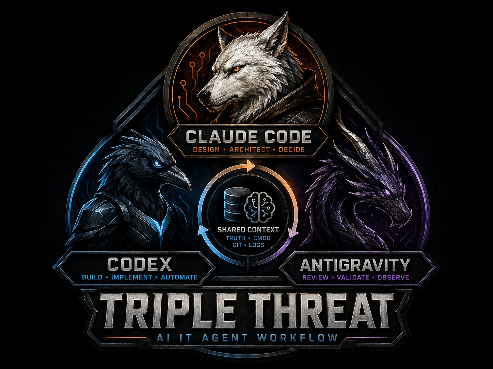

# Triple Threat


Status: active
Created: 2026-07-12
Owner: Felton
Builder: Codex / Claude / Antigravity (multi-agent orchestration)

## Purpose

An AI-assisted development workflow that sequences three coding agents (Claude, Codex, and Antigravity) through an eight-stage pipeline, stopping at five human approval gates instead of running unattended end to end.

It runs as a [DBOS](https://docs.dbos.dev/) durable workflow inside [`geekygramps-mcp`](https://github.com/fbrawner3/geekygramps-mcp) and invokes the agents through the shared agent-runner service. Rounds are launched, approved, and monitored from [The Arena](https://github.com/fbrawner3/the-arena). Every gate waits on a durable signal, so a crash or restart resumes the run where it stopped instead of starting over. An unanswered gate times out after seven days and cancels the run.

Triple Threat is separate from [Gauntlet](https://github.com/fbrawner3/gauntlet), the adversarial review workflow that can pressure-test its material.

## Pipeline

| # | Stage | Agent | Access |
| :-: | --- | --- | --- |
| 1 | Project design | Claude | writes artifact |
| 2 | Architecture | Claude | writes artifact |
| | **Gate: `post-architecture`** | | |
| 3 | Implementation review | Codex | review only |
| 4 | Architecture review | Antigravity | read-only |
| 5 | Adjudication and blocker manifest | Claude | writes artifact |
| | **Gate: `finalize-adjudication`** (blocker workshop) | | |
| 6 | Decision register | Claude | writes artifact |
| | **Gate: `post-decision-register`** | | |
| 7 | Implementation package and installation guide | Codex | writes project files |
| | **Gate: `post-implementation`** | | |
| 8 | Validation | Claude | read-only |
| | **Gate: `finalize-validated-runbook`** (warnings loop) | | |

Stages 3 and 4 run in parallel.

### Blocker workshop

Adjudication appends a machine-readable list of blockers, each with a stable ID, the question it raises, why it blocks, and a recommendation. The workflow seeds those into a workshop. The operator records a decision and evidence for each blocker and verifies it. The decision register stage only includes what was decided and verified, and it declines to produce a register if the manifest is not finalized.

### Validation warnings and remediation

Stage 8 returns a verdict, which the workflow classifies and records before the final gate. Validation warnings are worked at that gate in a loop that mirrors the blocker workshop. The final gate can also trigger a remediation pass: one more implementation and validation run with the validation failures as context. A pass is a deliberate human click, nothing repeats on its own, and a workflow is capped at three passes.

### Safety boundary

Every stage prompt forbids deploying, installing, applying, committing, or pushing, and by default forbids editing outside the project directory. A completed run hands over files and an installation guide for a separate, explicitly authorized rollout. Nothing deploys automatically.

## Knowledge and memory

Shared [vector memory](https://github.com/fbrawner3/vector-memory) is the source of truth for agent knowledge: PostgreSQL with hybrid retrieval (dense vector search plus full-text search, fused and reranked), reached through the MCP `search_memory` and `write_memory` tools. Each stage files its artifact there under a `tt_*` document type, and the installation guide from stage 7 is filed on its own as a runbook.

## HTTP API

| Method | Route | Purpose |
| --- | --- | --- |
| `POST` | `/tt-workflows` | Start a round |
| `GET` | `/tt-workflows/:workflowId` | Read run state |
| `GET` | `/tt-workflows/:workflowId/events` | Read the event log |
| `GET` | `/tt-workflows/:workflowId/artifacts` | Read stage artifacts |
| `GET` | `/tt-workflows-pending` | List runs waiting on a gate |
| `POST` | `/tt-workflows/:workflowId/approve/:gate` | Approve a gate |
| `POST` | `/tt-workflows/:workflowId/remediate` | Run one remediation pass |
| `GET`/`POST` | `/tt-workflows/:workflowId/blockers` | List or create blockers |
| `POST` | `/tt-workflows/:workflowId/blockers/:blockerId/decision` | Record a decision |
| `POST` | `/tt-workflows/:workflowId/blockers/:blockerId/verify` | Verify a blocker |
| `GET`/`POST` | `/tt-workflows/:workflowId/warnings` | List or create validation warnings |
| `POST` | `/tt-workflows/:workflowId/warnings/:warningId/resolution` | Record a resolution |
| `POST` | `/tt-workflows/:workflowId/warnings/:warningId/verify` | Verify a warning |

## Structure

```
src/workflows/tripleThreat.ts          DBOS workflow: stages, gates, blocker and warning loops
src/workflows/tripleThreatPrompts.ts   Stage definitions, agent assignment, and prompt templates
src/ttRoutes.ts                        HTTP routes
```

## Stack

- TypeScript, Fastify, DBOS (durable workflows)
- PostgreSQL (workflow, stage-job, blocker, and warning state)
- Three independent AI coding agents as stage executors, invoked through the agent-runner service

## Notes

This is a personal homelab tool, published for portfolio purposes. It is a reference implementation extracted from a larger private service. The modules it imports (service configuration, the DBOS store and types, the agent-runner client, the approvals page) are not included, so it will not build on its own.

An earlier version of this project was a PowerShell orchestrator. It has been replaced by the DBOS workflow above and is no longer in this repository.
